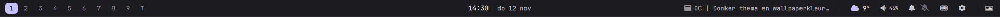
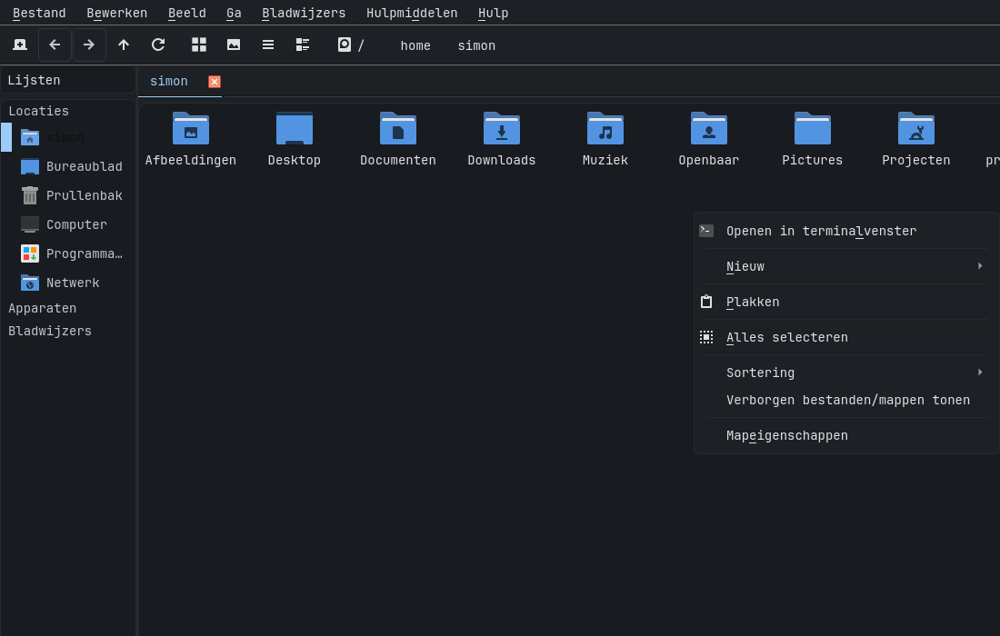

# BSPWM + Quickshell-desktop (Debian sid)

Een complete, dagelijks bruikbare X11-desktop met **bspwm** als window manager
en **Quickshell** voor de bar, notificaties, tray, instellingen en het
sneltoetsenoverzicht. De configuratie is één repository; er wordt niets
gekopieerd bij het starten.





## Wat zit erin

| Onderdeel | Functie |
|---|---|
| **Bar** | Workspaces (focus/bezet/urgent), layoutindicator, venstertitel, klok, weer, snapper, updates, MPRIS, volume, accu, meldingen, sneltoetsen, instellingen en systeemvak |
| **BSPWM-integratie** | Live status via `bspc subscribe report`; klikbare workspaces; herverbindt na `bspc wm -r` |
| **Weer** | Eindhoven via Open-Meteo, 10-minutenverversing, 3-daagse verwachting en offline cache |
| **Notificaties** | Quickshell is de enige `org.freedesktop.Notifications`-daemon: popups, geschiedenis (50), acties, DND en een centrum |
| **Systeemvak** | StatusNotifierItem (SNI) met menu's, tooltips, klikken en scrollen; geen legacy XEmbed |
| **Instellingen** | Live BSPWM-gaps, randen, padding, layouts, kleuren (8 presets), gedrag en de schaal van de interface (80–150%); opgeslagen in `settings.json` |
| **Sneltoetsen** | Doorzoekbaar overzicht dat rechtstreeks `~/.config/sxhkd/sxhkdrc` leest; eigen bindingen toevoegen, bewerken en verwijderen, met directe sxhkd-reload |
| **Volume** | Pipewire via Quickshell, met automatische `pactl`-terugval voor PulseAudio |
| **Accu** | UPower-widget, alleen zichtbaar als er echt een accu is |
| **Snapper** | Btrfs-momentopnamen in de bar: aantal, configuratiekeuze, lijst, aanmaken en verwijderen |
| **Updates** | APT- en Flatpak-updates: aantal in de bar, lijst per bron en bijwerken |
| **Sessie** | Sessiemenu in de bar (rofi-terugval), screenshots, wallpaper, vergrendelscript |
| **Wallpapers** | Venster met previews: toepassen, volgende, toevoegen via ingebouwde bestandsbrowser en verwijderen; downloadscript voor tien Griekse wallpapers |
| **Thema** | Donker (Adwaita-dark + Papirus-Dark) met een Material You-palet uit de wallpaper voor bar, bspwm-randen, GTK 3/4, Qt 6 (qt6ct), alacritty en rofi |

## Installatie-ISO (Calamares)

Naast handmatige installatie is er een reproduceerbare installatie-ISO:

```bash
sudo iso/build.sh
```

De ISO komt in `iso/out/quickshell-desktop-amd64.iso` (met `.sha256`). Hij
boot op BIOS en UEFI in een LXQt-live-sessie en start Calamares automatisch.
De installer schrijft dezelfde BTRFS-indeling als de bronmachine:

| Onderdeel | Waarde |
|---|---|
| EFI | GPT, 1 GiB FAT32 op `/boot/efi`, `umask=0077` |
| Root | één BTRFS-partitie, subvolume `@rootfs` |
| Mountopties | `noatime,compress=zlib:3,discard=async,space_cache=v2` |
| Snapshots | snapper-configuratie `root`, geneste `/.snapshots`, 50 nummer- en 10 tijdlijnmomentopnamen |
| Swap | geen (zoals op de bronmachine) |
| Bootloader | GRUB met `rootflags=subvol=@rootfs` |

Het project staat in het geïnstalleerde systeem in `/opt/quickshell`; de
gebruiker krijgt `~/projecten/quickshell` als symlink, zodat de bestaande
paden in `sxhkdrc`, Quickshell en de matugen-post-hook blijven werken.
Persoonlijke bestanden en Google Chrome gaan niet mee; matugen en de
meegeleverde wallpapers wel. Ontbreekt matugen op de buildmachine, dan haalt
`iso/build.sh` de officiële release eenmalig naar `iso/cache/`; een bestaande
binary is met `MATUGEN_BIN=...` te kiezen. Zie `iso/README.md` voor de
builddetails en `PLAN.md` (aanvullende fase) voor de ontwerpkeuzes.

## Vereisten

Getest op Debian sid (forky) met X11, SDDM, 1920×1080, bspwm 0.9.12,
sxhkd 0.6.3 en Quickshell 0.3.2.

```bash
sudo apt update
sudo apt install quickshell bspwm sxhkd jq curl xdotool \
  fonts-jetbrains-mono fonts-font-awesome papirus-icon-theme \
  picom feh rofi maim slop alacritty qt6ct \
  network-manager-applet blueman pavucontrol playerctl brightnessctl \
  pulseaudio-utils snapper btrfs-progs
```

Het Qt 6-thema gebruikt **qt6ct**. Heb je geen sudo-rechten, dan installeert
`scripts/install-qt6ct-user.sh` het pakket user-local in
`~/.local/opt/qt6ct`; `bspwmrc` zet daarvoor automatisch `QT_PLUGIN_PATH` en
`LD_LIBRARY_PATH`. Een systeempakket heeft de voorkeur, omdat het meelift met
Qt-updates.

Optioneel:

```bash
# Genest testen in een eigen X-server
sudo apt install xserver-xephyr

# Echt vergrendelen (dit project installeert bewust geen locker)
sudo apt install i3lock

# Polkit-popups (Quickshell heeft geen eigen agent).
# LXQt is als fallback geïnstalleerd en levert lxqt-policykit-agent;
# bspwmrc start die automatisch. Op een kale installatie:
sudo apt install lxqt-policykit

# Flatpak-updates in de update-widget (optioneel; zonder flatpak toont de
# widget alleen APT-updates).
sudo apt install flatpak
```

> `network-manager-gnome` bestaat niet meer in sid; `network-manager-applet`
> levert `nm-applet`. Die valt op deze build terug op XEmbed en verschijnt
> daarom niet in de Quickshell-tray. `nm-tray` (SNI) werkt wel.

Het kleurenpalet wordt met **matugen** uit de wallpaper gegenereerd. Matugen
staat niet in Debian; installeer de officiële release user-local (geen sudo):

```bash
mkdir -p ~/.local/bin
tmp=$(mktemp -d)
curl -fsSL -o "$tmp/matugen.tar.gz" \
  https://github.com/InioX/matugen/releases/download/v4.2.0/matugen-4.2.0-x86_64.tar.gz
tar -xzf "$tmp/matugen.tar.gz" -C "$tmp"
install -m755 "$tmp/matugen" ~/.local/bin/matugen
rm -rf "$tmp"
```

Zorg dat `~/.local/bin` in `PATH` staat. Zonder matugen blijft de desktop
werken met het vaste Catppuccin-palet en Variety/feh.

## Installatie

### 1. Repository op zijn plaats

De repo staat in dit project op `/home/simon/projecten/quickshell`. Kies je een
ander pad, vervang dan dat pad in de symlinks, in `config/sxhkd/sxhkdrc`
(de `qs -p …`-regels) en in de `post_hook` van
`config/matugen/config.toml`.

Op de installer-ISO staat het project in `/opt/quickshell`. De sessiewrapper
`/usr/local/bin/quickshell-session` draait bij de eerste login
`/usr/local/bin/quickshell-user-setup`; dat script maakt de symlinks, kopieert
de wallpaper en legt `~/projecten/quickshell` als symlink naar
`/opt/quickshell` aan. `bspwmrc` gebruikt `$QUICKSHELL_DIR` en valt terug op
`/opt/quickshell` als het project niet in de homemap staat.

### 2. Symlinks naar de configuratie

```bash
mkdir -p ~/.config/bspwm ~/.config/sxhkd ~/.config/picom ~/.config/rofi ~/.config/alacritty

ln -sf ~/projecten/quickshell/config/bspwm/bspwmrc ~/.config/bspwm/bspwmrc
ln -sf ~/projecten/quickshell/scripts/apply-bspwm-settings.sh ~/.config/bspwm/apply-settings.sh
ln -sf ~/projecten/quickshell/config/bspwm/settings.default.json ~/.config/bspwm/settings.default.json
ln -sf ~/projecten/quickshell/config/sxhkd/sxhkdrc ~/.config/sxhkd/sxhkdrc
ln -sf ~/projecten/quickshell/config/picom/picom.conf ~/.config/picom/picom.conf
ln -sf ~/projecten/quickshell/config/rofi/config.rasi ~/.config/rofi/config.rasi
ln -sf ~/projecten/quickshell/config/alacritty/alacritty.toml ~/.config/alacritty/alacritty.toml

chmod +x ~/projecten/quickshell/config/bspwm/bspwmrc \
         ~/projecten/quickshell/scripts/apply-bspwm-settings.sh \
         ~/projecten/quickshell/scripts/apply-wallpaper-theme.sh \
         ~/projecten/quickshell/scripts/apply-qt-theme.sh \
         ~/projecten/quickshell/scripts/wallpaper-theme.sh \
         ~/projecten/quickshell/scripts/install-qt6ct-user.sh \
         ~/projecten/quickshell/scripts/download-greek-wallpapers.sh \
         ~/projecten/quickshell/scripts/lock-session.sh \
         ~/projecten/quickshell/scripts/powermenu.sh

# Qt 6: de configuratie en het palet worden gegenereerd. Alleen de map en de
# stylesheet-symlink zijn nodig; apply-qt-theme.sh doet de rest bij login.
mkdir -p ~/.config/qt6ct/qss
ln -sf ~/projecten/quickshell/config/qt6ct/qss/quickshell.qss \
       ~/.config/qt6ct/qss/quickshell.qss
~/projecten/quickshell/scripts/apply-qt-theme.sh

# Het gebruikersbestand: één keer kopiëren. Quickshell schrijft hierna hierin.
[ -e ~/.config/bspwm/settings.json ] || \
  cp ~/projecten/quickshell/config/bspwm/settings.default.json ~/.config/bspwm/settings.json
```

### 3. Wallpaper, donker thema en kleuren

Zet een wallpaper op `~/Pictures/wallpaper.jpg` of in `~/Pictures/Wallpapers/`.
De tien Griekse wallpapers (Santorini, Athene, Meteora, Mykonos, Zakynthos,
Rhodos, Nafplio, Delphi, Kreta en Thessaloniki) haal je met:

```bash
~/projecten/quickshell/scripts/download-greek-wallpapers.sh
```

Genereer daarna het donkere kleurenpalet:

```bash
# Huidige wallpaper (of ~/Pictures/wallpaper.jpg) opnieuw toepassen
~/projecten/quickshell/scripts/wallpaper-theme.sh

# Volgende wallpaper uit ~/Pictures/Wallpapers/
~/projecten/quickshell/scripts/wallpaper-theme.sh next

# Een specifieke afbeelding
~/projecten/quickshell/scripts/wallpaper-theme.sh ~/Pictures/Wallpapers/wallpaper-03.jpg
```

Het script doet vijf dingen:

1. zet de wallpaper met `feh`;
2. genereert met matugen een donker Material You-palet uit die wallpaper:
   `~/.config/bspwm/theme.generated.json` voor Quickshell en
   `colors.toml`, `colors.rasi` en `gtk.css` voor alacritty, rofi en GTK 3/4;
3. neemt de BSPWM-randkleuren over in `~/.config/bspwm/settings.json` en past
   ze direct toe met `bspc`;
4. activeert **Adwaita-dark** en **Papirus-Dark** voor GTK3, GTK4 en
   libadwaita-apps (`gsettings` + `settings.ini`);
5. schrijft het **Qt 6-palet** en de qt6ct-configuratie, zodat Qt-apps dezelfde
   kleuren, JetBrains Mono en 6px-hoeken gebruiken als de Quickshell-widgets.

`bspwmrc` draait het script bij elke login en `Super+W` gaat naar de volgende
wallpaper. Zonder matugen valt de sessie terug op Variety of een vaste
wallpaper via feh; het Catppuccin-palet blijft dan als terugval actief.

#### Qt 6-thema

Qt-apps volgen dezelfde ontwerptaal als de bar. `scripts/apply-qt-theme.sh`
leest `~/.config/bspwm/theme.generated.json` en schrijft:

- `~/.config/qt6ct/colors/quickshell-dark.conf` — het QPalette, met `base` als
  vensterachtergrond, `mantle` als invoerveld, `surface0`/`surface1` als
  knoppen en randen, en `accent` (de BSPWM-focuskleur) als selectie;
- `~/.config/qt6ct/qt6ct.conf` — Fusion als stijl, JetBrains Mono 10,5 pt en
  Papirus-Dark als iconenthema.

De vormgeving staat in `config/qt6ct/qss/quickshell.qss`: 6px-hoeken,
surface-hovers, accent-onderstreping bij tabs, slanke schuifbalken en menu's
in dezelfde kleuren als de popups. De stylesheet gebruikt `palette(...)`, dus
een nieuwe wallpaper werkt zonder de QSS aan te passen. `bspwmrc` zet
`QT_QPA_PLATFORMTHEME=qt6ct`; zonder qt6ct valt de sessie terug op het
donkere GTK-thema.

Na een wallpaperwissel nemen nieuwe Qt-vensters de kleuren direct over.
Bestaande vensters houden hun palette tot ze opnieuw starten.

Het wallpapervenster open je met het afbeeldingsicoon in de bar of met
`Super+Shift+W`. Het toont previews van alle wallpapers, past de selectie toe
(hetzelfde script als `Super+W`), en heeft een ingebouwde bestandsbrowser om
afbeeldingen uit bijvoorbeeld `~/Pictures` of een USB-stick toe te voegen. Bij
toevoegen wordt het bestand naar `~/Pictures/Wallpapers/` gekopieerd; het
origineel blijft staan. Verwijderen kan alleen uit die map en nooit de actieve
wallpaper. De credits van de meegeleverde foto's staan in
`docs/wallpaper-credits.md`.

### 4. Inloggen en starten

Kies bij SDDM de sessie **bspwm**. `bspwmrc` start sxhkd, picom, de wallpaper en
Quickshell. Handmatig starten kan ook:

```bash
qs -p /home/simon/projecten/quickshell
```

LXQt blijft als aparte sessie in SDDM staan en is niet aangepast.

Wil je dat Quickshell na een crash automatisch terugkomt, start de sessie dan
met `QUICKSHELL_WATCHDOG=1` (bijvoorbeeld via `~/.xprofile`). Zonder die
variabele start `bspwmrc` Quickshell alleen bij login/`bspc wm -r`, zodat een
crash niet eindeloos wordt gemaskeerd.

## Sneltoetsen

De volledige, altijd actuele lijst staat in Quickshell zelf:

- **`Super+/`** opent het doorzoekbare overzicht.
- **`Super+Shift+S`** opent de BSPWM-instellingen.
- `docs/keybindings.md` is een momentopname van dezelfde sxhkdrc.

In het overzicht voeg je met **Nieuwe sneltoets** je eigen bindingen toe:
toetsen, omschrijving, groep en commando. Eigen bindingen krijgen potlood- en
prullenbakiconen en zijn direct te bewerken of verwijderen. Na opslaan schrijft
Quickshell de binding in dezelfde `~/.config/sxhkd/sxhkdrc` (als gemarkeerd
`@qs-shortcut`-blok) en herlaadt sxhkd met `pkill -USR1 sxhkd`. Handmatige
regels en secties in de sxhkdrc blijven daarbij onaangeroerd; alleen blokken
met een marker zijn vanuit de GUI aanpasbaar.

Belangrijkste combinaties:

| Categorie | Sneltoets | Actie |
|---|---|---|
| Apps | `Super+Return` | Alacritty |
| Apps | `Super+D` | rofi-launcher |
| Apps | `Super+Shift+B` / `Super+Shift+F` | Firefox / pcmanfm-qt |
| Vensters | `Super+H/J/K/L` | Focus links/onder/boven/rechts |
| Vensters | `Super+Shift+H/J/K/L` | Venster verplaatsen |
| Vensters | `Super+Q` / `Super+Shift+Q` | Sluiten / geforceerd beëindigen |
| Vensters | `Super+F` / `Super+S` / `Super+T` | Fullscreen / zwevend / betegelen |
| Workspaces | `Super+1…9` | Desktop focussen |
| Workspaces | `Super+Shift+1…9` | Venster meenemen en volgen |
| Workspaces | `Super+Tab` | Vorige desktop |
| Layout | `Super+M` / `Super+Shift+T` | Monocle / volgende layout |
| Layout | `Super+Shift+R` / `Super+Shift+Space` / `Super+Shift+E` | Roteren / balanceren / equalizen |
| Preselect | `Super+Ctrl+H/J/K/L`, `Super+Escape` | Preselectie maken / annuleren |
| Media | `XF86Audio*`, `XF86MonBrightness*`, `XF86AudioPlay/Next/Prev` | pactl / brightnessctl / playerctl |
| Screenshots | `Print`, `Shift+Print`, `Super+Print` | scherm / regio / venster |
| Sessie | `Super+Alt+L` | Vergrendelen (zie beperkingen) |
| Sessie | `Super+Alt+E` | BSPWM afsluiten |
| Sessie | `Super+Shift+P` | Sessiemenu in de bar |
| Sessie | `Super+Ctrl+R` / `Super+Ctrl+S` | BSPWM herstarten / sxhkd herladen |
| Quickshell | `Super+Shift+S` / `Super+/` | Instellingen / sneltoetsen |
| Quickshell | `Super+Shift+N` / `Super+Shift+D` | Notificatiecentrum / DND |

> **Afwijkingen van het oorspronkelijke plan:** `Super+Shift+L` en
> `Super+Shift+E` botsten met de verplaats-/equalize-combinaties. Vergrendelen
> is daarom `Super+Alt+L`, BSPWM afsluiten `Super+Alt+E`. Balanceren gebruikt
> `Super+Shift+Space` omdat `Super+Shift+B` de browser opent.

Na een wijziging in `sxhkdrc`:

```bash
pkill -USR1 sxhkd
```

Het sneltoetsenoverzicht leest het bestand opnieuw bij openen; een lopend
overzicht kan met `qs -p … ipc call shortcuts toggle` worden gesloten en weer
geopend.

## Configuratiepaden

| Pad | Rol |
|---|---|
| `config/bspwm/bspwmrc` | Sessiestart; past `settings.json` toe en start hulptools |
| `config/bspwm/settings.default.json` | Standaardwaarden voor gaps, randen, kleuren, gedrag, layout en interfaceschaal |
| `~/.config/bspwm/settings.json` | Echte gebruikersbestand; Quickshell schrijft hierin |
| `config/sxhkd/sxhkdrc` | Enige bron voor sneltoetsen én het overzicht; eigen bindingen uit de GUI staan onderaan tussen `@qs-shortcut`-markers |
| `config/picom/picom.conf` | Compositor (xrender, afgestemd op de VM-GPU) |
| `config/rofi/config.rasi` | Wallpaper-thema voor launcher en sessiemenu |
| `config/alacritty/alacritty.toml` | Terminal; importeert de gegenereerde kleuren |
| `config/matugen/config.toml` | Paletgenerator en templatelijst |
| `config/matugen/templates/` | Templates voor Quickshell, GTK 3/4, alacritty en rofi |
| `config/qt6ct/qss/quickshell.qss` | Qt Widgets-stijl: hoeken, menu's, tabs en schuifbalken |
| `~/.config/qt6ct/qt6ct.conf` | Gegenereerde qt6ct-configuratie (Fusion, font, iconen) |
| `~/.config/qt6ct/colors/quickshell-dark.conf` | Gegenereerd QPalette uit het wallpaper-palet |
| `~/.config/bspwm/theme.generated.json` | Gegenereerd palette (Quickshell leest dit live) |
| `scripts/apply-bspwm-settings.sh` | Zet JSON om naar `bspc config` bij start/herstart |
| `scripts/apply-qt-theme.sh` | Schrijft het Qt 6-palet en de qt6ct-configuratie |
| `scripts/install-qt6ct-user.sh` | Installeert qt6ct user-local als er geen sudo is |
| `scripts/wallpaper-theme.sh` | Wallpaper zetten + donker palet genereren en toepassen |
| `scripts/download-greek-wallpapers.sh` | Tien Griekse wallpapers naar `~/Pictures/Wallpapers/` halen |
| `scripts/apply-wallpaper-theme.sh` | Post-hook: palet → `settings.json` + `bspc` |
| `scripts/lock-session.sh` | Zoekt een locker; anders een melding |
| `scripts/powermenu.sh` | Opent het powermenu in de bar; rofi-terugval als Quickshell niet draait |
| `docs/keybindings.md` | Leesbare momentopname van de sneltoetsen |

De bar leest `theme.generated.json` voor het volledige palet en
`settings.json` voor de accent- en randkleuren. Het wallpaper-script houdt die
twee synchroon, zodat een kleurwijziging in het instellingenvenster direct
doorwerkt in zowel de BSPWM-randen als de bar.

## IPC

Gebruik bij deze deployment altijd `-p`, omdat Quickshell niet in de
standaardconfiguratiemap staat:

```bash
qs -p /home/simon/projecten/quickshell ipc show
qs -p /home/simon/projecten/quickshell ipc call settings toggle
qs -p /home/simon/projecten/quickshell ipc call shortcuts toggle
qs -p /home/simon/projecten/quickshell ipc call notifications dnd true
qs -p /home/simon/projecten/quickshell ipc call weather refresh
qs -p /home/simon/projecten/quickshell ipc call wallpaper status

# Eigen sneltoets toevoegen, aanpassen en verwijderen
qs -p /home/simon/projecten/quickshell ipc call shortcuts add \
  'super + shift + e' 'Editor openen' 'alacritty -e vim' 'Mijn apps'
qs -p /home/simon/projecten/quickshell ipc call shortcuts update \
  'qs-…' 'super + shift + e' 'Editor openen' 'alacritty -e nvim' 'Mijn apps'
qs -p /home/simon/projecten/quickshell ipc call shortcuts remove 'qs-…'
```

Beschikbare doelen:

| Doel | Functies |
|---|---|
| `bar` | `reload`, `toggle` |
| `settings` | `open`, `close`, `toggle`, `status`, `reset`, `setGap`, `setBorder`, `setColor`, `setScale`, `setBarOpacity`, `save` |
| `shortcuts` | `open`, `close`, `toggle`, `status`, `list`, `add`, `update`, `remove`, `reload` |
| `notifications` | `status`, `clear`, `dnd`, `getDnd`, `toggleDnd`, `open`, `close`, `toggle` |
| `weather` | `status`, `refresh`, `open`, `close`, `toggle` |
| `snapper` | `status`, `list`, `refresh`, `open`, `close`, `toggle`, `config`, `editor`, `create`, `remove`, `cleanup`, `rollback` |
| `updates` | `status`, `refresh`, `open`, `close`, `toggle`, `update` |
| `wallpaper` | `status`, `list`, `refresh`, `open`, `close`, `toggle`, `next`, `set`, `add`, `remove` |
| `power` | `status`, `open`, `close`, `toggle`, `lock`, `logout`, `sleep`, `shutdown` |
| `bspwm` | `status` |
| `tray` | `status` |

De schaal van de bar, widgets, popups en vensters staat in `settings.json`
onder `ui.scale` (0.8–1.5). In het instellingenvenster vind je die terug op het
tabblad **Weergave**; via IPC kan het ook, met een percentage:

```bash
qs -p /home/simon/projecten/quickshell ipc call settings setScale 125
```

De barachtergrond is standaard semi-transparant. Het dekkingsniveau staat in
`settings.json` onder `ui.bar_opacity` (0.3–1.0; standaard 0.8) en is op
hetzelfde tabblad in te stellen. Via IPC geef je de dekking in procenten:

```bash
qs -p /home/simon/projecten/quickshell ipc call settings setBarOpacity 85
```

## Widgets en diensten

### Volume

`VolumeWidget` gebruikt `Quickshell.Services.Pipewire` als PipeWire draait.
Deze machine draait PulseAudio zonder PipeWire-daemon; de widget valt dan
automatisch terug op `pactl` en blijft live verversen. Klik = dempen, scroll =
±5%.

### Accu

`BatteryWidget` leest `UPower.displayDevice` en is alleen zichtbaar als
`isPresent` waar is en het percentage boven nul ligt. Op een desktop blijft de
widget dus weg.

### Snapper

`SnapperWidget` toont het aantal btrfs-momentopnamen in de actieve
snapper-configuratie. Klikken opent een popup met de lijst (nieuwste eerst),
de configuratiekeuze en knoppen om een momentopname aan te maken, te
verwijderen, op te ruimen of terug te rollen. Aanmaken opent een klein
FloatingWindow voor de beschrijving; verwijderen, opruimen en rollback vragen
om een tweede klik. **Opruimen** verwijdert de oudste momentopnamen tot er
maximaal 10 overblijven; standaard- en actieve momentopnamen blijven daarbij
beschermd. Een **rollback** wordt per momentopname met het ↶-icoon gestart,
maakt nieuwe momentopnamen aan en wordt pas actief na een herstart. De lijst
ververst elke twee minuten en bij het openen van de popup.

Lezen gebeurt met `snapper --jsonout list` en `snapper --jsonout
list-configs`. Snapper beheert de momentopnamen via de root-daemon `snapperd`;
een gewone gebruiker krijgt pas toegang als hij in `ALLOW_USERS` van de
configuratie staat. Dat is een eenmalige root-handeling:

```bash
sudo scripts/setup-snapper-access.sh              # gebruiker = SUDO_USER
sudo scripts/setup-snapper-access.sh -c root simon
```

Het script voegt de gebruiker toe aan `ALLOW_USERS`, zet `SYNC_ACL=yes`,
werkt de ACL van `.snapshots` bij en controleert daarna of `snapper list` als
die gebruiker werkt. Let op: daarmee mag die gebruiker ook door de inhoud van
de momentopnamen van dat subvolume bladeren. Handmatig kan het ook:

```bash
sudo snapper -c root set-config "ALLOW_USERS=$USER SYNC_ACL=yes"
sudo setfacl -m "u:$USER:rx" /.snapshots
```

Daarna werken bekijken, aanmaken, verwijderen, opruimen en rollback zonder
sudo of polkit: alle bewerkingen lopen via `snapperd`. Zonder die rechten blijft
de widget zichtbaar met een gedempte telling en toont de popup het exacte
commando. Aanmaken, verwijderen, opruimen en rollback vallen dan terug op
`pkexec`, wat een draaiende polkit-agent vereist (zie **Polkit**). Met
`SNAPPER_ELEVATE` is dat elevatiecommando te vervangen (bijvoorbeeld
`SNAPPER_ELEVATE='sudo -n'` of leeg voor geen elevatie). `SNAPPER_BIN` en
`SNAPPER_CONFIG` zijn handig voor tests of een afwijkende installatie.

Een rollback wijzigt de standaard-subvolume van het hele systeem en wordt pas
actief na een herstart. Snapper ondersteunt dit alleen voor de root-subvolume;
bij andere configuraties krijgt de rollbackknop een slotje. De popup waarschuwt
verder en vraagt om een tweede klik. Handmatig kan het ook met
`sudo snapper -c <config> rollback <nummer>`.

### Updates

`UpdatesWidget` toont het aantal beschikbare updates uit twee bronnen:
APT (`apt list --upgradable`) en Flatpak (`flatpak remote-ls --updates`).
Klikken opent een popup met de pakketten per bron, de oude en nieuwe versie
(bij APT) of de versie en remote (bij Flatpak), en de knop **Bijwerken**. Die
knop werkt eerst de systeempakketten bij en daarna de Flatpaks; omdat dit
systeemwijzigingen zijn, vraagt hij om een tweede klik. De lijst ververst elke
30 minuten en bij het openen van de popup.

APT-updates worden met
`pkexec sh -c "apt-get update && apt-get -y full-upgrade"` uitgevoerd;
Flatpak regelt eventuele bevoegdheid zelf via polkit. `full-upgrade` is nodig
voor updates die nieuwe dependencies installeren of verouderde pakketten
vervangen; met een gewone `upgrade` blijven die als “kept back” in de lijst
staan. Met `UPDATES_ELEVATE` is het elevatiecommando te vervangen (bijvoorbeeld
`UPDATES_ELEVATE='sudo -n'` of leeg voor geen elevatie). `UPDATES_APT_BIN` en
`UPDATES_FLATPAK_BIN` zijn handig voor tests of een afwijkende installatie.
Ontbreekt Flatpak, dan blijft de widget APT-updates tonen en staat in de popup
alleen de melding dat Flatpak ontbreekt.

### MPRIS

`MprisWidget` toont de eerste speler met een nummer. Linksklik = play/pause,
scrollen = volgende/vorige. Zonder speler is de widget onzichtbaar.

### Notificaties

Quickshell bezit `org.freedesktop.Notifications`. Start geen
`lxqt-notificationd`, dunst of een andere daemon in de bspwm-sessie. Testen:

```bash
scripts/test-notifications.sh all
```

### Powermenu

De aan/uit-knop rechts in de bar opent een menu met afmelden, vergrendelen,
slapen en afsluiten. De acties lopen via de `Power`-service: afmelden gebruikt
`bspc quit`, slapen en afsluiten `systemctl suspend` en `systemctl poweroff`,
en vergrendelen hergebruikt `scripts/lock-session.sh` (met `QS_LOCK_SCRIPT` is
een ander lockscript te kiezen). `Super+Shift+P` opent hetzelfde menu via
`qs ipc call power toggle`; `scripts/powermenu.sh` valt terug op rofi als de
bar niet draait.

### Tray

Alleen SNI wordt ondersteund. `nm-applet` valt op deze Debian-build terug op
XEmbed en verschijnt niet; gebruik bijvoorbeeld `nm-tray`. Menu's worden met
QtWidgets' `QMenu` getekend; daarom staat `//@ pragma UseQApplication` boven aan
`shell.qml`.

## Tests

```bash
# Syntax van de sxhkd-config (op een eigen display, anders grabbed sxhkd de keys)
sxhkd -c config/sxhkd/sxhkdrc

# QML-log van de draaiende shell
tail -f /tmp/quickshell-$USER.log

# Geneste bspwm-sessie (fase 1)
scripts/test-fase1-nested.sh

# Notificaties
scripts/test-notifications.sh basic|critical|action|all

# Wallpaper-thema opnieuw genereren (en het resultaat controleren)
scripts/wallpaper-theme.sh
jq '.palette' ~/.config/bspwm/theme.generated.json
gsettings get org.gnome.desktop.interface color-scheme

# IPC-diagnostiek
qs -p ~/projecten/quickshell ipc call bspwm status
qs -p ~/projecten/quickshell ipc call shortcuts status
qs -p ~/projecten/quickshell ipc call settings status
qs -p ~/projecten/quickshell ipc call power status
qs -p ~/projecten/quickshell ipc call snapper status
qs -p ~/projecten/quickshell ipc call updates status
qs -p ~/projecten/quickshell ipc call wallpaper status
```

Updates zijn ook zonder muis te testen:

```bash
# Status met APT- en Flatpak-tellingen en de gevonden pakketten
qs -p ~/projecten/quickshell ipc call updates status
qs -p ~/projecten/quickshell ipc call updates refresh

# Popup openen en alles bijwerken (IPC start direct, zonder bevestiging)
qs -p ~/projecten/quickshell ipc call updates open
qs -p ~/projecten/quickshell ipc call updates update
```

Snapper kan ook zonder muis worden getest:

```bash
# Lijst met configuraties en momentopnamen
qs -p ~/projecten/quickshell ipc call snapper status
qs -p ~/projecten/quickshell ipc call snapper list

# Wisselen, aanmaken en verwijderen
qs -p ~/projecten/quickshell ipc call snapper config root
qs -p ~/projecten/quickshell ipc call snapper create "voor update"
qs -p ~/projecten/quickshell ipc call snapper remove 12

# Oudste momentopnamen verwijderen tot er maximaal 10 overblijven
qs -p ~/projecten/quickshell ipc call snapper cleanup 10

# Rollback voorbereiden; actief na een herstart
qs -p ~/projecten/quickshell ipc call snapper rollback 12

# Beschrijving invoeren via het venster
qs -p ~/projecten/quickshell ipc call snapper editor
```

Het wallpapervenster is ook zonder muis te testen:

```bash
# Lijst met alle wallpapers en de actieve keuze
qs -p ~/projecten/quickshell ipc call wallpaper list

# Een specifieke wallpaper toepassen (script doet feh + matugen + bspc)
qs -p ~/projecten/quickshell ipc call wallpaper set \
  ~/Pictures/Wallpapers/griekenland-01-santorini-oia.jpg

# Toevoegen (kopieert naar ~/Pictures/Wallpapers)
qs -p ~/projecten/quickshell ipc call wallpaper add ~/Pictures/foto.jpg
```

## Problemen oplossen

| Symptoom | Oorzaak / oplossing |
|---|---|
| `qs ipc call` zegt “Could not find … shell.qml” | Gebruik `qs -p /home/simon/projecten/quickshell ipc …` |
| QML-fout of bar verdwijnt | Bekijk `/tmp/quickshell-$USER.log`; daarna `qs -p … ipc call bar reload` |
| Bar bedekt door fullscreen | Test `bspc config ignore_ewmh_fullscreen enter`; vastgelegd als bekende X11-beperking (issue #290) |
| Popup krijgt geen toetsenbordfocus | Bekend X11-probleem (issue #794); popups hebben daarom geen tekstinvoer, instellingen/sneltoetsen zijn FloatingWindows |
| Dubbel zoveel ruimte boven vensters | Bar-strut + bspwm-padding; houd `padding` in het instellingenvenster op 0 |
| Geen notificatiepopups | Controleer of een andere daemon `org.freedesktop.Notifications` bezit; `qs ipc call notifications status` toont het conflict |
| Geen tray-icoon | App gebruikt XEmbed in plaats van SNI; kies een SNI-app |
| Geen app-iconen in meldingen | `bspwmrc` zet `QT_QPA_PLATFORMTHEME=qt6ct` (of `gtk3` als qt6ct ontbreekt); log opnieuw in als die variabele nog niet in je sessie staat |
| Qt-apps gebruiken de lichte Fusion-standaardstijl | qt6ct of de plugin ontbreekt; installeer `qt6ct` of draai `scripts/install-qt6ct-user.sh`, controleer `~/.config/qt6ct/qt6ct.conf` en log opnieuw in |
| Qt-kleuren lopen achter na een wallpaperwissel | Draai `scripts/apply-qt-theme.sh` (of `scripts/wallpaper-theme.sh`); nieuwe Qt-vensters nemen het palet over, bestaande pas na een herstart |
| Weer blijft op oude waarde | Offline: cache + “laatst bijgewerkt” blijven staan; `qs ipc call weather status` toont de fout |
| Kleuren veranderen niet na een nieuwe wallpaper | `command -v matugen` of `~/.local/bin/matugen`; draai `scripts/wallpaper-theme.sh` en bekijk `~/.config/bspwm/theme.generated.json` |
| GTK-apps blijven licht | Draai `scripts/wallpaper-theme.sh` (zet `gsettings` + `~/.config/gtk-*/settings.ini`); bestaande apps kunnen een herstart nodig hebben |
| Alacritty toont geen thema | `~/.config/alacritty/colors.toml` ontbreekt; draai `scripts/wallpaper-theme.sh`. Controleer de symlink van `alacritty.toml` |
| Volume-widget toont niets | Zowel PipeWire als `pactl`/PulseAudio ontbreken; installeer `pulseaudio-utils` |
| Snapper-widget zegt “Geen toegang” | Draai eenmalig `sudo scripts/setup-snapper-access.sh` (zet `ALLOW_USERS` + `SYNC_ACL`; zie **Snapper**). Met polkit kan het ook via `pkexec scripts/setup-snapper-access.sh "$USER"`. Het exacte commando staat ook in de popup |
| Snapper-actie vraagt om bevoegdheid maar er gebeurt niets | Controleer of `lxqt-policykit-agent` draait (`pgrep -af lxqt-policykit-agent`); stel anders `ALLOW_USERS` in (dan is pkexec niet nodig) of gebruik `SNAPPER_ELEVATE='sudo -n'` |
| Updates blijven staan na **Bijwerken** | De resterende pakketten zijn “kept back” en vragen `apt-get full-upgrade` (nieuwe dependencies of te vervangen pakketten). De widget gebruikt dat commando; klik nogmaals op **Bijwerken**. Controleer vooraf met `apt-get -s full-upgrade` |
| `Super+Alt+L` vergrendelt niet | Er is geen locker geïnstalleerd; installeer `i3lock` of `xsecurelock`. Het script toont nu een melding |
| Geen polkit-popups | `bspwmrc` start `lxqt-policykit-agent` (uit `lxqt-policykit`); controleer `pgrep -af lxqt-policykit-agent` en `systemctl status polkit polkit-agent-helper.socket`. `lxpolkit` is een alternatief, maar werkte op deze machine niet met polkit 128 |
| `bspc wm -r` verbreekt de bar | De Bspwm-service herverbindt binnen enkele seconden; geen actie nodig |
| sxhkd start niet | Controleer `sxhkd -c ~/.config/sxhkd/sxhkdrc` en `pgrep -a sxhkd` |

### Bekende beperkingen

- Alleen X11; Wayland-specifieke Quickshell-functies worden niet gebruikt.
- Eén scherm is getest; de code maakt wel per scherm een bar aan.
- Legacy XEmbed-trayiconen worden niet ondersteund.
- Op deze VM ontbreken een echte accu, een backlight en een schermvergrendeling;
  de widgets/scripts degraderen zichtbaar en veilig.
- De foto’s in `docs/` zijn van de testsessie op 1920×1080; de Qt-screenshot
  is genomen in een geneste Xephyr op 1100×700.

## Bestandsstructuur

```text
shell.qml                     # root: bars, vensters, services, IPC
src/
  theme/Theme.qml             # singleton; leest settings.json + wallpaper-palet
  services/                   # Bspwm, BspwmSettings, Weather, Notifications, Power, Wallpaper, Snapper, Updates
  components/                 # Bar, Workspaces, widgets (o.a. Snapper en Updates), Keycap, tray
  components/settings/        # herbruikbare instellingenbesturing
  popups/                     # weer, notificatiestack, notificatiecentrum, powermenu, snapper, updates
  windows/                    # SettingsWindow, ShortcutsWindow, WallpaperWindow, SnapperCreateWindow
  utils/                      # ReportParser.js, SxhkdParser.js, WeatherCodes.js
config/
  bspwm/                      # bspwmrc, settings.default.json
  sxhkd/sxhkdrc               # enige bron voor sneltoetsen
  picom/picom.conf
  rofi/config.rasi
  alacritty/alacritty.toml
  qt6ct/qss/quickshell.qss    # Qt Widgets-stijl voor het wallpaper-palet
  matugen/                    # config.toml + templates voor het wallpaper-palet
scripts/
  apply-bspwm-settings.sh
  apply-wallpaper-theme.sh
  apply-qt-theme.sh
  wallpaper-theme.sh
  install-qt6ct-user.sh       # fallback zonder sudo
  setup-snapper-access.sh     # eenmalig: ALLOW_USERS + SYNC_ACL voor de widget
  download-greek-wallpapers.sh
  lock-session.sh
  powermenu.sh
  test-fase1-nested.sh
  test-notifications.sh
docs/
  keybindings.md
  wallpaper-credits.md
  screenshot-*.png
```

## Licentie

Deze configuratie is projectspecifiek en vrij te gebruiken en aan te passen.
De gebruikte programma's (bspwm, sxhkd, Quickshell, rofi, enz.) hebben hun eigen
licenties.
